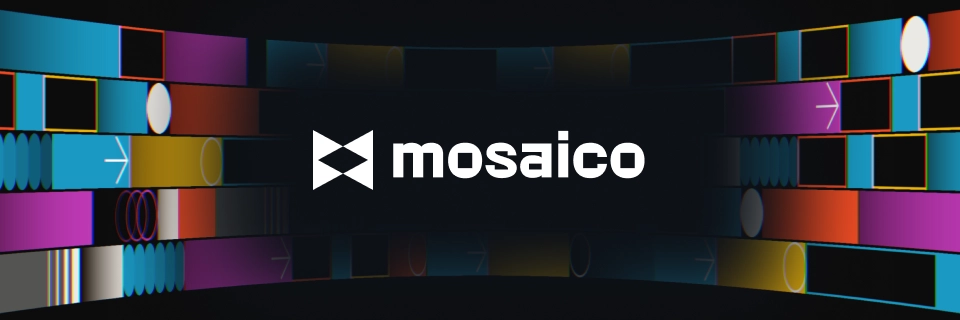
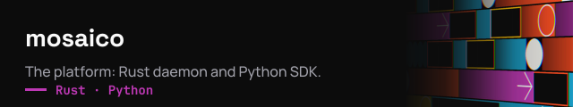
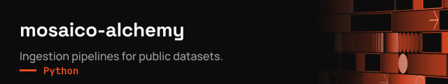
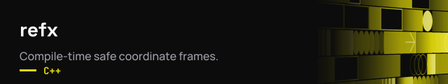

<a href="https://github.com/mosaico-labs/mosaico"></a>

<p align="center">
  <a href="https://github.com/mosaico-labs/mosaico"></a>
  <a href="https://docs.mosaico.dev"></a>
  <a href="https://pypi.org/project/mosaicolabs"></a>
  <a href="https://discord.gg/mwQtFnsckE"></a>
</p>

We build **[Mosaico](https://github.com/mosaico-labs/mosaico)**, an open-source (Apache 2.0) data platform for robotics. It takes ROS bags, MCAP files and other sensor logs and turns them into a typed, indexed archive running on your own machines. You can then search recordings by what happened in them and stream just the time slice you need into your code, without parsing whole files.

<p align="center">
  <a href="https://github.com/mosaico-labs/mosaico"></a>
</p>

### Getting started

```bash
curl -fsSL https://get.mosaico.dev | sh                            # mosaicod + mosaicoctl, Linux & macOS
pip install mosaicolabs                                            # Python SDK
mosaicolabs.ros_injector --file run_042.mcap --sequence run_042    # load a recording
```

Prefer containers? `mosaicod` is also published as an image (`latest`, `x.y`, `x.y.z` and `nightly` tags), and the [install guide](https://docs.mosaico.dev/daemon/install) has a ready-to-use compose file with PostgreSQL:

```bash
docker pull ghcr.io/mosaico-labs/mosaicod:latest
```

Then see the [getting started guide](https://docs.mosaico.dev/getting_started) and the [Python SDK docs](https://docs.mosaico.dev/python-sdk/).

### Discord

Our [Discord](https://discord.gg/mwQtFnsckE) is where we talk with the people using Mosaico: questions about the SDK, how to organize robotics data, what's coming next, and where hackathons and challenges are announced. The team is there every day.

<a href="https://discord.gg/mwQtFnsckE"></a>

### Repositories

<p>
  <a href="https://github.com/mosaico-labs/mosaico"></a>
  <a href="https://github.com/mosaico-labs/mosaico-alchemy"></a>
  <a href="https://github.com/mosaico-labs/mosaico-test-datasets"></a>
  <a href="https://github.com/mosaico-labs/refx"></a>
</p>

### Hackathons and challenges

<a href="https://discord.gg/mwQtFnsckE"></a>

We regularly run robotics hackathons and challenges. If you're taking part in one, [mosaico-alchemy](https://github.com/mosaico-labs/mosaico-alchemy) and [mosaico-test-datasets](https://github.com/mosaico-labs/mosaico-test-datasets) give you real data to practice on, and [`llms-full.txt`](https://docs.mosaico.dev/llms-full.txt) has the whole documentation in one file for your coding agent. During events you'll find us on [Discord](https://discord.gg/mwQtFnsckE).

### Contributing

Bug reports, questions and design proposals are all welcome: use [issues](https://github.com/mosaico-labs/mosaico/issues) for bugs and [discussions](https://github.com/mosaico-labs/mosaico/discussions) for ideas and RFCs. Read [CONTRIBUTING.md](https://github.com/mosaico-labs/mosaico/blob/main/CONTRIBUTING.md) before opening a PR. The C++ and Rust SDKs are still in development, and new sensor adapters are always useful.

<sub>[mosaico.dev](https://mosaico.dev) · [LinkedIn](https://www.linkedin.com/company/mosaico-labs) · we're [hiring](https://mosaicolabs.notion.site/Work-Mosaico-27d56ff886238051a797db5e22ba813e)</sub>
